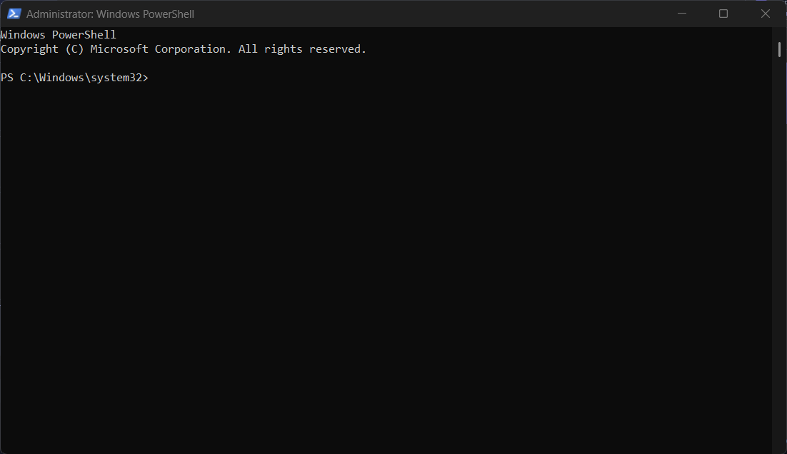

# Yêu cầu đầu ra
 
1. Promt
```text
Bạn là người hướng dẫn Git kiên nhẫn, nói chuyện cho người mới học. Tôi đang cần push code lên GitHub thì Terminal báo: error: open(".git/FETCH_HEAD"): Permission denied. Tôi chạy lại vẫn bị. Hãy giải thích lỗi này bằng kỹ thuật feynman, nêu 2–3 nguyên nhân hay gặp và hướng dẫn từng bước sửa.
```
2. 


3.  

```text
Lỗi Git: Permission denied khi push code, đã thử Run as Administrator vẫn lỗi

Chào thầy, em gặp lỗi khi đẩy code lên GitHub và cần hỗ trợ vì sắp đến deadline.

1. Bối cảnh

Hệ điều hành: Windows 11, 
Phần mềm: git version 2.56.0.windows.2, dùng Git Bash

2. Hành vi mong muốn 

Mở Terminal tại thư mục dự án, gõ git push và code được đẩy lên GitHub thành công.

3. Thực tế 

Terminal báo lỗi ngay khi chạy lệnh.
Đã thử chạy lại và chạy bằng Run as Administrator, vẫn bị lỗi tương tự.

4. Ảnh chụp màn hình

Log nguyên văn (tiếng Anh):
error: open(".git/FETCH_HEAD"): Permission denied
Ảnh đính kèm: 

Em cảm ơn thầy ạ.
```